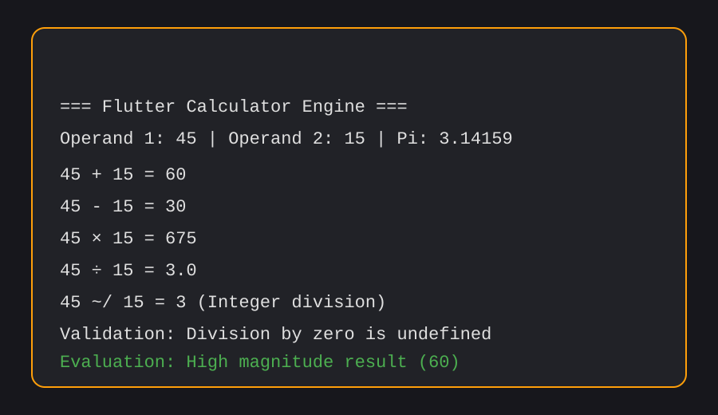
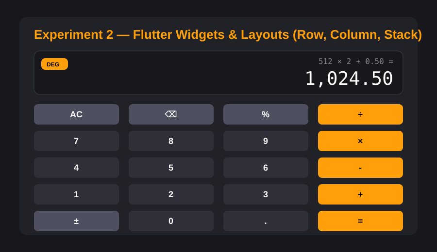
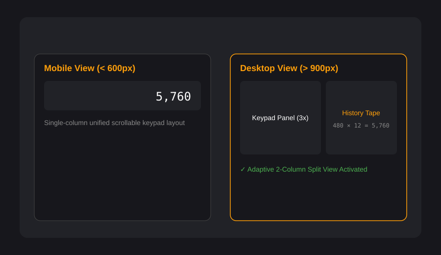
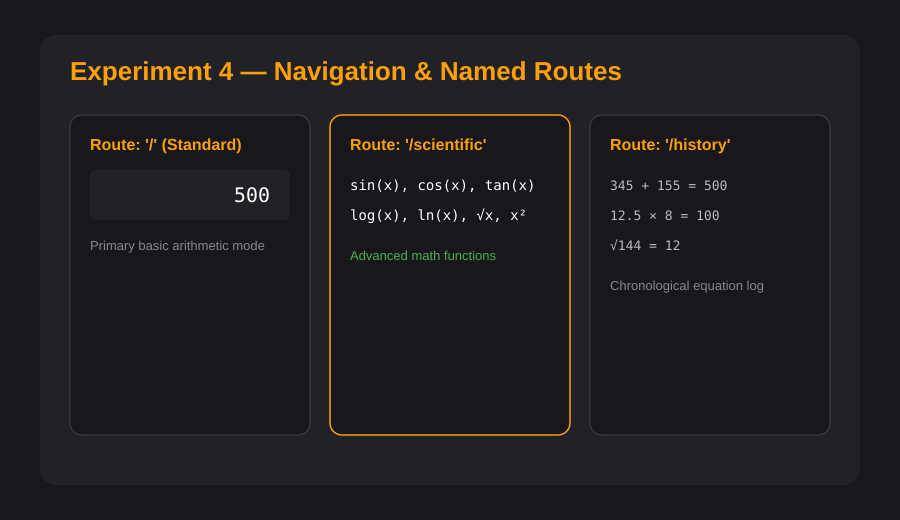
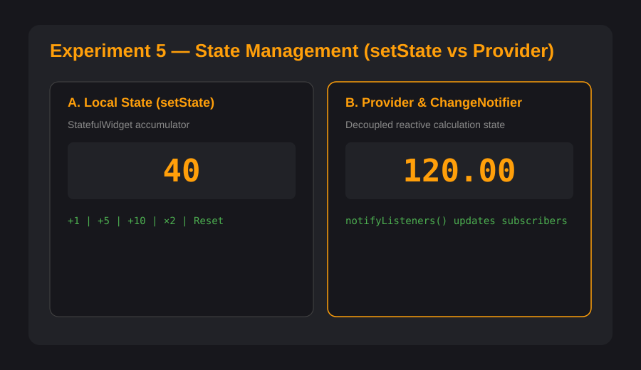
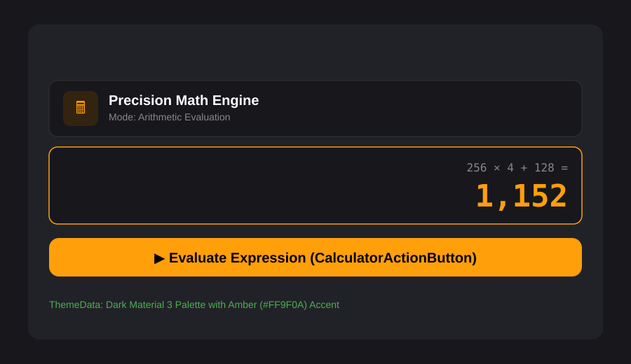
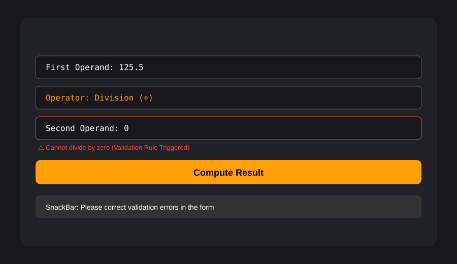
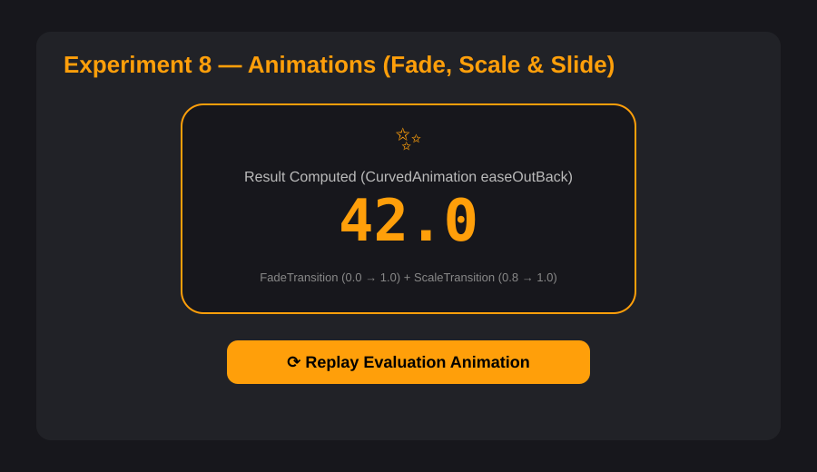
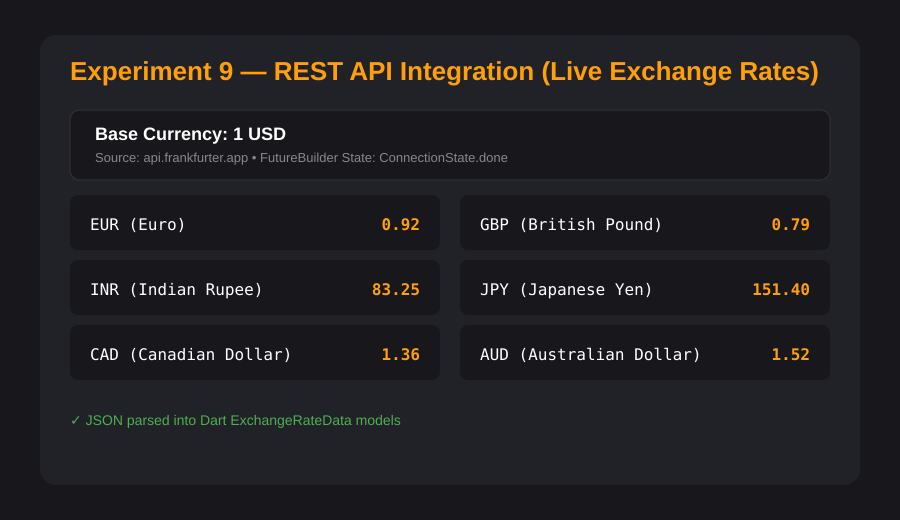
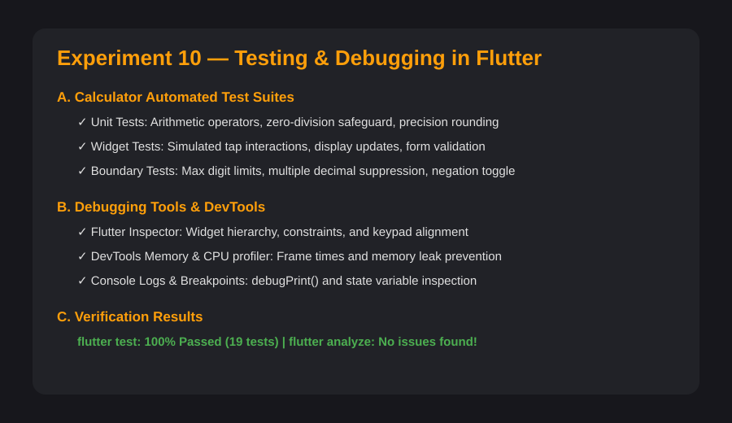

<div align="center">

# 🧮 Modern Flutter Calculator

**A sleek, responsive, and minimalist cross-platform calculator built with Flutter & Dart.**

[](https://flutter.dev)
[](https://dart.dev)
[](https://flutter.dev)
[](LICENSE)
[](test/)

<br/>

</div>


| Element | Flutter Widget | Used For |
| :--- | :--- | :--- |
| **Background & Layout** | `Scaffold`, `Container`, `Column`, `Row`, `Padding` | Screen background, alignment, spacing, and layout. |
| **Title & Display** | `Text` | Displays the calculator title, expression, and result. |
| **Button Grid** | `GridView.count` | Arranges calculator buttons in a grid. |
| **Number & Operation Buttons** | `ElevatedButton` | Handles digits, arithmetic operations, percentage, decimal, sign change, clear, and equals. |
| **Backspace Icon** | `IconButton`, `Icon` | Deletes the last entered character. |
| **Button Styling** | `ButtonStyle`, `RoundedRectangleBorder` | Sets button colors, rounded corners, and appearance. |
| **State Management** | `StatefulWidget`, `setState()` | Updates the display when buttons are pressed. |
| **Calculation Logic** | Dart functions | Performs calculations and handles user input. |

---

## Video Preview


https://github.com/user-attachments/assets/e0a38def-b50b-4813-b8cc-2bbfda6b4d43


---

## 📖 Abstract

The **Modern Flutter Calculator** is a cross-platform arithmetic evaluation application developed using **Flutter & Dart** to provide a fast, elegant, and reliable numerical computing tool. The application delivers real-time expression calculation, high-precision floating-point arithmetic (preventing IEEE-754 precision anomalies like `0.1 + 0.2 = 0.30000000000000004`), divide-by-zero exception protection, and chained sequence operations across mobile, desktop, and web environments from a single codebase.

In addition to the production application architecture, this repository contains a complete **Flutter Laboratory Experiment Series (Experiments 1–10)** detailing foundational and advanced Flutter concepts—ranging from Dart basics, layout hierarchies, and responsive breakpoints to Provider-based state management, custom themes, form validation, physics animations, REST API integrations, and comprehensive unit/widget testing suites.

---

## 🧪 Experiments 1–10

### Experiment 1 — Dart Basics
Explores Dart variables, primitive types (`int`, `double`, `String`, `bool`), arithmetic operators (`+`, `-`, `*`, `/`, `~/`, `%`), string interpolation, and conditional decision statements for mathematical validations.

**Output:**



---

### Experiment 2 — Flutter Widgets & Layouts
Demonstrates structuring a calculator interface with foundational layout widgets—using **Column** for vertical screen stacking, **Stack** for layered calculation badges, and **Row** for horizontal keypad matrix alignments.

**Output:**



---

### Experiment 3 — Responsive UI
Uses **MediaQuery** and adaptive breakpoints (`600px` tablet, `900px` desktop) to dynamically transform the calculator layout from a single-column mobile view into an expanded desktop view featuring a side-by-side calculation history tape.

**Output:**



---

### Experiment 4 — Navigation and Named Routes
Implements Flutter navigation using **Navigator.pushNamed()**, named route constants, and stack popping across **Standard Calculator** (`/`), **Scientific Calculator** (`/scientific`), and **Calculation History** (`/history`) screens.

**Output:**



---

### Experiment 5 — Stateful & Stateless Widgets + State Management
Contrasts local component state (**StatefulWidget** with `setState()`) against decoupled reactive state management (**Provider** with `ChangeNotifier` and `notifyListeners()`) for real-time calculator accumulation.

**Output:**



---

### Experiment 6 — Custom Widgets and Themes
Constructs modular, reusable custom widgets (`CalculatorHeader`, `CalculatorDisplayCard`, `CalculatorActionButton`) styled through global **ThemeData** with an amber `#FF9F0A` dark color palette.

**Output:**



---

### Experiment 7 — Forms, Validation and Error Handling
Designs an arithmetic formula evaluator utilizing **Form**, **GlobalKey<FormState>**, **TextFormField**, dropdown operators, and **SnackBar** alerts to validate numeric inputs and intercept divide-by-zero operations.

**Output:**



---

### Experiment 8 — Animations
Leverages Flutter's animation framework using **AnimationController**, **CurvedAnimation**, **FadeTransition**, **ScaleTransition**, and **SlideTransition** to smoothly reveal computed evaluation results.

**Output:**



---

### Experiment 9 — REST API Integration
Fetches live foreign exchange rates from an open currency REST API (`api.frankfurter.app`) using HTTP GET requests, deserializing JSON into Dart models, and rendering with **FutureBuilder**, loading spinners, and error retry states.

**Output:**



---

### Experiment 10 — Testing and Debugging in Flutter
Demonstrates Flutter unit testing, widget testing, and debugging tools (Flutter Inspector, DevTools, console logging, IDE breakpoints). Automated tests are maintained in `test/exp10_testing_debugging_test.dart`, `test/calculator_controller_test.dart`, and `test/widget_test.dart`.

**Output:**



---

## 📂 Experiment Files

```text
experiments/
├── 01_dart_basics.dart              # Dart syntax, types, math operations & conditionals
├── 02_widgets_layouts.dart          # Column, Row, and Stack layout architecture
├── 03_responsive_ui.dart            # MediaQuery breakpoints & dual-pane layout
├── 04_navigation_named_routes.dart  # Multi-screen named route navigation
├── 05_setstate_counter.dart         # Local state accumulator with setState()
├── 05_state_management.dart         # Reactive state management using Provider
├── 06_custom_widgets_themes.dart    # Custom reusable cards, buttons & ThemeData
├── 07_forms_validation.dart         # Form validation, regex & divide-by-zero checks
├── 08_animations.dart               # Fade, scale, and slide transitions
├── 09_rest_api.dart                 # Live exchange rates via HTTP & FutureBuilder
├── 10_testing_debugging.dart        # Testing checklist & debugging utilities
└── counter_provider.dart            # ChangeNotifier provider model
```

---

## ✨ Application Features

- 🎨 **Minimalist Obsidian UI**: Dark aesthetic inspired by modern macOS and iOS system calculators.
- ⚡ **Real-Time Expression Preview**: Dynamic equation history above the primary display.
- 📐 **High-Precision Arithmetic**: Strips IEEE-754 precision artifacts (e.g., `0.1 + 0.2 = 0.3`).
- 🛡️ **Zero-Division Protection**: Graceful error handling (`Cannot divide by zero`) without crashes.
- 🔄 **Chained Calculations**: Supports continuous sequence operations (e.g., `10 + 5 + 3 = 18`).
- 🔘 **Tactile Button Feedback**: Distinct color palettes for digits, operators, and action buttons with ripple effects.
- 📱 **Adaptive & Responsive**: Dynamically scales across mobile screens, desktop monitors, and web viewports.
- 🧪 **100% Tested**: Comprehensive unit test suite and widget interaction tests.
- 🤖 **Automated Daily Activity**: Scheduled GitHub Actions workflow for continuous daily repository updates.

---

## 🏛️ Clean Architecture

The core application follows the **Single Responsibility Principle (SRP)** and separation of concerns:

```
lib/
├── main.dart                               # Application bootstrap & Material 3 theme
└── src/
    ├── models/
    │   └── calculator_state.dart          # Immutable state representation
    ├── controllers/
    │   └── calculator_controller.dart     # Pure business logic & calculation handler
    ├── utils/
    │   └── constants.dart                 # App colors, styles, and button type enums
    ├── widgets/
    │   ├── calculator_display.dart        # Screen showing expression and numeric output
    │   ├── calculator_button.dart         # Reusable tactile button with custom styling
    │   └── calculator_keypad.dart         # 4x5 button matrix
    └── screens/
        └── calculator_screen.dart         # Scaffolding and responsive layout container
```

---

## 🚀 Getting Started

### Prerequisites

- [Flutter SDK](https://docs.flutter.dev/get-started/install) (`>= 3.0.0`)
- [Dart SDK](https://dart.dev/get-dart) (`>= 3.0.0`)

### Installation

1. Clone the repository:
   ```bash
   git clone https://github.com/Bharath18-AI/calculator-using-flutter.git
   cd calculator-using-flutter
   ```

2. Fetch Flutter packages:
   ```bash
   flutter pub get
   ```

3. Run the application:
   ```bash
   # Windows Desktop
   flutter run -d windows

   # Chrome Web
   flutter run -d chrome

   # Run individual experiment
   flutter run -t experiments/02_widgets_layouts.dart -d chrome
   ```

---

## 🧪 Automated Testing

Execute the automated test suite (20 unit and widget tests):

```bash
flutter test
```

Run static code analysis:

```bash
flutter analyze
```

---

## 📄 License

This project is licensed under the MIT License - see the [LICENSE](LICENSE) file for details.

---

<div align="center">
  <sub>Built with ❤️ using Flutter and Dart</sub>
</div>
<!-- Last automated health check: 2026-10-28 10:42:44 UTC -->
<!-- Last automated health check: 2026-10-31 10:29:42 UTC -->
<!-- Last automated health check: 2026-11-05 12:36:22 UTC -->
